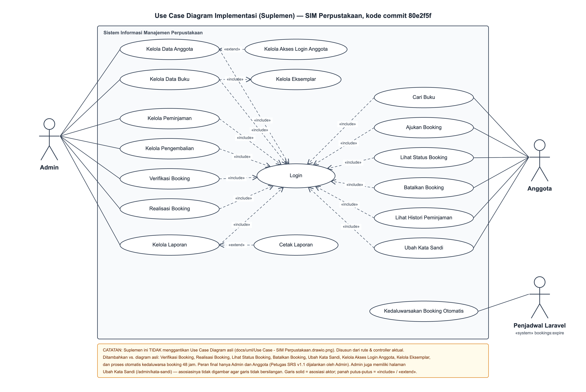

# 2. Use Case Diagram

Status: **COMPLETE** — diagram akademik asli tersedia dan terbaca; suplemen selaras implementasi dibuat terpisah.

## A. Diagram asli (Tugas 3) — sumber akademik, tidak diubah

Berkas: [`docs/uml/Use Case - SIM Perpustakaan.drawio.png`](../../uml/Use%20Case%20-%20SIM%20Perpustakaan.drawio.png) (1902 × 1098 px)

Isi: aktor **Admin** (Kelola Data Anggota, Kelola Data Buku, Peminjaman Buku, Pengembalian Buku, Kelola Laporan «extend» Lihat/Cetak Laporan) dan **Anggota** (Cari Buku, Booking Pinjam Buku, Lihat History Peminjaman); semua «include» Login.

## B. Suplemen implementasi (dibuat 21 Nov 2026 dari rute & controller aktual)

Berkas: [`use-case-implementasi.png`](suplemen-implementasi/use-case-implementasi.png) · sumber vektor [`use-case-implementasi.svg`](suplemen-implementasi/use-case-implementasi.svg)

## C. Perbandingan asli vs implementasi

| Use case yang diminta | Diagram asli | Implementasi (rute) | Keterangan |
| --- | --- | --- | --- |
| Login (Admin & Anggota) | Ada | `GET/POST /login`, `POST /logout` | Sesuai |
| Kelola Anggota | Ada | `/admin/anggota*` | + Kelola Akses Login Anggota («extend») |
| Kelola Buku | Ada | `/admin/buku*` | Sesuai |
| Kelola Eksemplar | **Tidak ada** (terkandung di Kelola Buku) | Eksemplar dikelola di formulir buku | Ditambahkan sebagai «include» |
| Kelola Peminjaman | Ada ("Peminjaman Buku") | `/admin/peminjaman` | Sesuai |
| Kelola Pengembalian | Ada ("Pengembalian Buku") | `/admin/pengembalian` | Sesuai |
| Verifikasi Booking | **Tidak ada** | `/admin/booking/verifikasi`, `POST …/setujui`, `…/tolak` | Ditambahkan (SRS FR-033/034) |
| Realisasi Booking | **Tidak ada** | `/admin/booking/realisasi`, `POST …/realisasi` | Ditambahkan (SRS FR-026/035) |
| Laporan | Ada | `/admin/laporan` | Cetak via browser |
| Cari Buku | Ada | `/anggota/cari-buku` | Sesuai |
| Ajukan Booking | Ada ("Booking Pinjam Buku") | `/anggota/booking/ajukan`, `POST /anggota/booking` | Sesuai |
| Batalkan Booking | **Tidak ada** | `POST /anggota/booking/{kode}/batalkan` | Ditambahkan (FR-032) |
| Lihat Status Booking | **Tidak ada** | `/anggota/booking/status` | Ditambahkan |
| Lihat Histori Peminjaman | Ada | `/anggota/history` | Sesuai |
| Ubah Kata Sandi | **Tidak ada** | `/anggota/kata-sandi` (juga `/admin/kata-sandi`) | Ditambahkan (wajib saat login pertama Anggota) |
| — | — | `bookings:expire` (penjadwal) | Aktor sistem «Penjadwal Laravel» ditambahkan |

Peran **Petugas** tidak ada di diagram asli maupun implementasi; SRS §2.3 masih memuatnya (lihat [catatan deviasi SRS](../01-SRS/README.md#8-catatan-deviasi-implementasi-keputusan-yang-disetujui-pemilik-proyek)).
