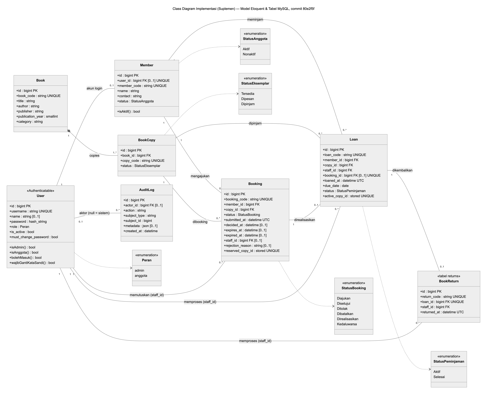

# 3. Class Diagram

Status: **COMPLETE** — Class Diagram akademik asli tersedia; suplemen tingkat implementasi dibuat terpisah dari model Eloquent dan migration.

## A. Diagram asli (Tugas 6) — sumber akademik, tidak diubah

Berkas: [`docs/uml/Class Diagram.drawio.png`](../../uml/Class%20Diagram.drawio.png) (2200 × 1519 px). Kelas konseptual: Pengguna (abstrak) ← Admin, Anggota; Buku 1 ◆— 1..* EksemplarBuku; BookingPeminjaman; Peminjaman 1 — 0..1 Pengembalian; Laporan (virtual).
Object Diagram pendukung: [Peminjaman Aktif](../../uml/Object%20Diagram-02%20-%20Object%20-%20Peminjaman%20Aktif.drawio.png), [Booking Buku](../../uml/Object%20Diagram-03%20-%20Object%20-%20Booking%20Buku.drawio.png), [Pengembalian Selesai](../../uml/Object%20Diagram-04%20-%20Object%20-%20Pengembalian%20Selesai.drawio.png).

## B. Suplemen implementasi — model Eloquent & tabel MySQL (commit 80e2f5f)

Berkas: [`class-diagram-implementasi.png`](suplemen-implementasi/class-diagram-implementasi.png) · sumber Mermaid [`class-diagram-implementasi.mmd`](suplemen-implementasi/class-diagram-implementasi.mmd) · SVG [`class-diagram-implementasi.svg`](suplemen-implementasi/class-diagram-implementasi.svg)

Sumber kebenaran: `app/Models/*.php`, `app/Enums/*.php`, `database/migrations/*.php`.

| Kelas (tabel) | Atribut kunci | Relasi & kardinalitas | Foreign key (semua `RESTRICT`) | Tanggung jawab utama |
| --- | --- | --- | --- | --- |
| `User` (`users`) | `username` UNIQUE, `password` (hash), `role` admin/anggota, `is_active`, `must_change_password` | 1 — 0..1 Member; 1 — 0..* Booking/Loan/BookReturn (sebagai staff); 0..1 — 0..* AuditLog | — | Identitas login, kelayakan masuk (`bolehMasuk`), kewajiban ganti kata sandi |
| `Member` (`members`) | `member_code` UNIQUE, `name`, `contact`, `status` Aktif/Nonaktif | 1 — 0..* Booking, 1 — 0..* Loan | `user_id` → users (opsional, UNIQUE) | Data keanggotaan; status menentukan hak pinjam/booking/login |
| `Book` (`books`) | `book_code` UNIQUE, judul, penulis, penerbit, tahun, kategori | 1 ◆— 1..* BookCopy | — | Data bibliografi |
| `BookCopy` (`book_copies`) | `copy_code` UNIQUE, `status` Tersedia/Dipesan/Dipinjam | 1 — 0..* Booking, 1 — 0..* Loan | `book_id` → books | Unit fisik yang dipinjam/dipesan |
| `Booking` (`bookings`) | `booking_code`, `status` (6 nilai), `submitted_at`, `decided_at`, `expires_at`, `expired_at`, `rejection_reason`, `reserved_copy_id` (kolom tersimpan, UNIQUE) | 1 — 0..1 Loan | `member_id`, `copy_id`, `staff_id` | Reservasi; maksimal satu booking Disetujui per eksemplar |
| `Loan` (`loans`) | `loan_code`, `loaned_at`, `due_date`, `status` Aktif/Selesai, `active_copy_id` (tersimpan, UNIQUE) | 1 — 0..1 BookReturn | `member_id`, `copy_id`, `staff_id`, `booking_id` (UNIQUE, opsional) | Peminjaman; maksimal satu pinjaman Aktif per eksemplar |
| `BookReturn` (`returns`) | `return_code`, `returned_at` | — | `loan_id` (UNIQUE), `staff_id` | Pengembalian; mencegah pengembalian ganda |
| `AuditLog` (`audit_logs`) | `action`, `subject_type`, `subject_id`, `metadata` JSON | — | `actor_id` (null = sistem/penjadwal) | Jejak audit; tidak dapat diubah/dihapus lewat Eloquent |

## C. Perbedaan asli vs implementasi

- Pewarisan `Admin`/`Anggota` ⊂ `Pengguna` diimplementasikan sebagai satu tabel `users` dengan kolom `role`; data keanggotaan terpisah di `members` dan akun login Anggota **opsional** (SRS 6.1 `members.user_id?`).
- Ditambahkan sesuai SRS 6.1: `due_date`, `staff_id` pada Loan/BookReturn/Booking, atribut keputusan booking, dan kelas `AuditLog` (NFR-015) — tidak ada di Class Diagram asli.
- Status booking bertambah `Kedaluwarsa` (keputusan 48 jam). `Laporan` tidak menjadi tabel (query virtual, `app/Queries/LaporanPerpustakaan.php`).
