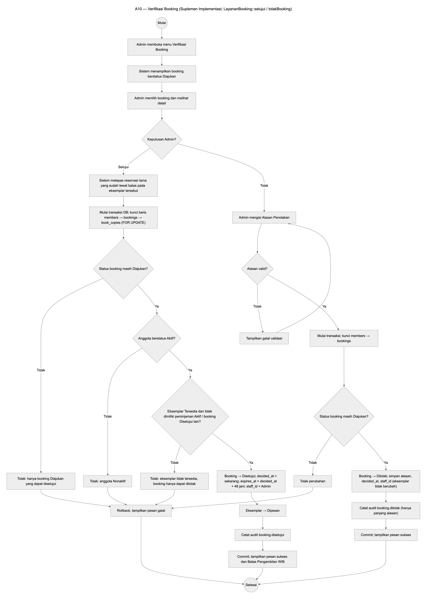

# 4. Activity Diagram

Status: **COMPLETE** — sembilan Activity Diagram asli (A01–A09) tersedia; tiga suplemen dibuat untuk alur yang tidak dimodelkan di diagram asli.

## A. Diagram asli (Tugas 4) — sumber akademik, tidak diubah

| Prioritas | Alur | Berkas | Kesesuaian dengan aplikasi |
| --- | --- | --- | --- |
| 1 | Login | [A01](../../uml/Activity%20Diagram-A01%20-%20Login.drawio.png) | Sesuai (implementasi menambah rate limit & wajib ganti kata sandi) |
| 2 | Kelola Anggota | [A02](../../uml/Activity%20Diagram-A02%20-%20Kelola%20Data%20Anggota.drawio.png) | Sesuai; implementasi menambah aktif/nonaktif dan akses login |
| 3 | Kelola Buku | [A03](../../uml/Activity%20Diagram-A03%20-%20Kelola%20Data%20Buku.drawio.png) | Diagram tidak memodelkan eksemplar; implementasi wajib ≥1 eksemplar |
| 4 | Peminjaman | [A04](../../uml/Activity%20Diagram-A04%20-%20Peminjaman%20Buku.drawio.png) | Diagram memakai model "stok"; implementasi memakai status per eksemplar + jatuh tempo |
| 5 | Pengembalian | [A05](../../uml/Activity%20Diagram-A05%20-%20Pengembalian%20Buku.drawio.png) | Sesuai |
| — | Kelola Laporan | [A06](../../uml/Activity%20Diagram-A06%20-%20Kelola%20Laporan.drawio.png) | Sesuai; "simpan" tidak diwujudkan sebagai ekspor berkas (TBD-07) |
| — | Cari Buku | [A07](../../uml/Activity%20Diagram-A07%20-%20Cari%20Buku.drawio.png) | Sesuai |
| 6 | Ajukan Booking | [A08](../../uml/Activity%20Diagram-A08%20-%20Booking%20Pinjam%20Buku.drawio.png) | Sesuai untuk pengajuan; berhenti sebelum verifikasi |
| — | Lihat History | [A09](../../uml/Activity%20Diagram-A09%20-%20Lihat%20History%20Peminjaman.drawio.png) | Sesuai (identitas dari sesi server) |

Contoh (A04 Peminjaman Buku):

## B. Suplemen implementasi (alur yang belum ada di diagram asli)

| # | Alur | PNG | Sumber Mermaid | Dasar kode |
| --- | --- | --- | --- | --- |
| A10 | Verifikasi Booking (setujui/tolak) | [PNG](suplemen-implementasi/A10-verifikasi-booking.png) | [.mmd](suplemen-implementasi/A10-verifikasi-booking.mmd) | `LayananBooking::setujui`, `::tolakBooking` |
| A11 | Realisasi Booking | [PNG](suplemen-implementasi/A11-realisasi-booking.png) | [.mmd](suplemen-implementasi/A11-realisasi-booking.mmd) | `LayananBooking::realisasikan` |
| A12 | Kedaluwarsa booking otomatis (48 jam) | [PNG](suplemen-implementasi/A12-kedaluwarsa-booking-otomatis.png) | [.mmd](suplemen-implementasi/A12-kedaluwarsa-booking-otomatis.mmd) | `KedaluwarsakanBooking`, `LayananKedaluwarsaBooking::prosesJatuhTempo` |

Langkah pada suplemen diambil langsung dari urutan pemeriksaan di service (bukan rekaan). Transkripsi teks diagram asli: [`docs/analisis/uml-activity-sequence.md`](../../analisis/uml-activity-sequence.md).
