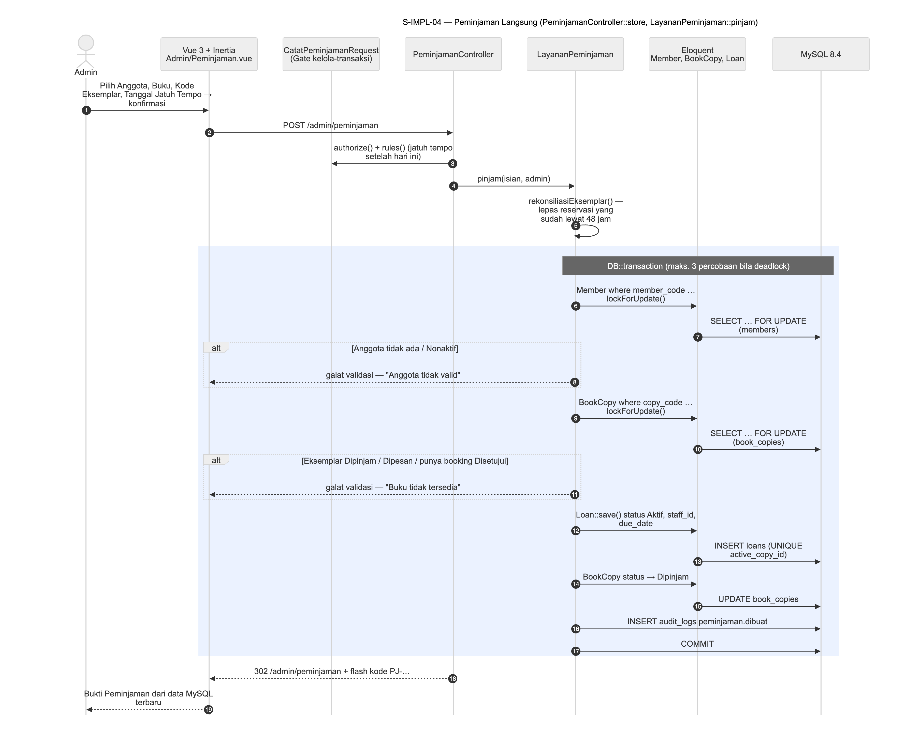

# 5. Sequence Diagram

Status: **COMPLETE** — sembilan Sequence Diagram asli (S01–S09, tingkat analisis boundary/control/entity) tersedia; delapan suplemen tingkat implementasi dibuat terpisah.

## A. Diagram asli (Tugas 4) — sumber akademik, tidak diubah

Lifeline: Aktor → «boundary» Antarmuka → «control» Layanan → «entity» Basis Data.

[S01 Login](../../uml/SEQUENCE%20Diagram-S01%20-%20Login.drawio.png) ·
[S02 Kelola Data Anggota](../../uml/SEQUENCE%20Diagram-S02%20-%20Kelola%20Data%20Anggota.drawio.png) ·
[S03 Kelola Data Buku](../../uml/SEQUENCE%20Diagram-S03%20-%20Kelola%20Data%20Buku.drawio.png) ·
[S04 Peminjaman Buku](../../uml/SEQUENCE%20Diagram-S04%20-%20Peminjaman%20Buku.drawio.png) ·
[S05 Pengembalian Buku](../../uml/SEQUENCE%20Diagram-S05%20-%20Pengembalian%20Buku.drawio.png) ·
[S06 Kelola Laporan](../../uml/SEQUENCE%20Diagram-S06%20-%20Kelola%20Laporan.drawio.png) ·
[S07 Cari Buku](../../uml/SEQUENCE%20Diagram-S07%20-%20Cari%20Buku.drawio.png) ·
[S08 Booking Pinjam Buku](../../uml/SEQUENCE%20Diagram-S08%20-%20Booking%20Pinjam%20Buku.drawio.png) ·
[S09 Lihat History](../../uml/SEQUENCE%20Diagram-S09%20-%20Lihat%20History%20Peminjaman.drawio.png)

## B. Suplemen implementasi

Lifeline nyata: Aktor → **Vue 3 + Inertia** (halaman di `resources/js/Pages`) → **Form Request + Gate** → **Controller** → **Service** → **Eloquent** → **MySQL 8.4**. Blok biru = `DB::transaction` dengan `SELECT … FOR UPDATE`.

| # | Skenario | PNG | Sumber |
| --- | --- | --- | --- |
| S-IMPL-01 | Login | [PNG](suplemen-implementasi/S-IMPL-01-login.png) | [.mmd](suplemen-implementasi/S-IMPL-01-login.mmd) |
| S-IMPL-02 | Tambah Anggota (+ akses login) | [PNG](suplemen-implementasi/S-IMPL-02-tambah-anggota.png) | [.mmd](suplemen-implementasi/S-IMPL-02-tambah-anggota.mmd) |
| S-IMPL-03 | Tambah Buku & Eksemplar | [PNG](suplemen-implementasi/S-IMPL-03-tambah-buku.png) | [.mmd](suplemen-implementasi/S-IMPL-03-tambah-buku.mmd) |
| S-IMPL-04 | Peminjaman langsung | [PNG](suplemen-implementasi/S-IMPL-04-peminjaman.png) | [.mmd](suplemen-implementasi/S-IMPL-04-peminjaman.mmd) |
| S-IMPL-05 | Pengembalian | [PNG](suplemen-implementasi/S-IMPL-05-pengembalian.png) | [.mmd](suplemen-implementasi/S-IMPL-05-pengembalian.mmd) |
| S-IMPL-06 | Ajukan Booking | [PNG](suplemen-implementasi/S-IMPL-06-ajukan-booking.png) | [.mmd](suplemen-implementasi/S-IMPL-06-ajukan-booking.mmd) |
| S-IMPL-07 | Setujui Booking | [PNG](suplemen-implementasi/S-IMPL-07-setujui-booking.png) | [.mmd](suplemen-implementasi/S-IMPL-07-setujui-booking.mmd) |
| S-IMPL-08 | Realisasi Booking | [PNG](suplemen-implementasi/S-IMPL-08-realisasi-booking.png) | [.mmd](suplemen-implementasi/S-IMPL-08-realisasi-booking.mmd) |

Catatan teknis yang tercermin di diagram:
- Galat validasi/aturan bisnis dilempar sebagai `ValidationException`; untuk request Inertia, Laravel mengembalikan *redirect back* dengan `errors` di sesi (bukan halaman galat).
- Urutan kunci baris yang seragam di semua service: `members → bookings → book_copies → loans → returns` (lihat `app/Services/Transaksi/DasarTransaksi.php`); deadlock diulang otomatis maks. 3 kali.
- Pesan sukses dikirim lewat *flash* **setelah commit**.
