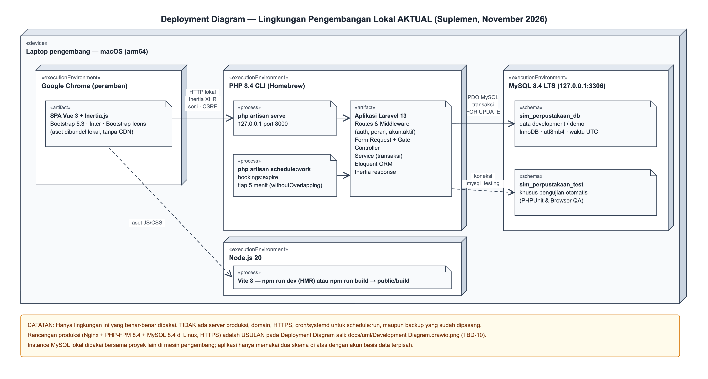

# 6. Deployment Diagram

Status: **COMPLETE** — Deployment Diagram asli (rancangan produksi **usulan**) tersedia; suplemen lingkungan lokal **aktual** dibuat terpisah.

> Aplikasi saat ini **hanya berjalan di lingkungan pengembangan lokal**. Tidak ada server produksi, domain, HTTPS, cron, maupun backup yang sudah dipasang. Tidak ada URL publik.

## A. Lingkungan lokal AKTUAL (suplemen, 21 Nov 2026)

Berkas: [`deployment-lokal-aktual.png`](suplemen-implementasi/deployment-lokal-aktual.png) · SVG [`deployment-lokal-aktual.svg`](suplemen-implementasi/deployment-lokal-aktual.svg)

| Komponen | Nilai aktual |
| --- | --- |
| Perangkat | Laptop pengembang macOS (arm64) |
| Runtime aplikasi | PHP 8.4 CLI (Homebrew `php@8.4`), `php artisan serve` → `127.0.0.1:8000` |
| Frontend | Vue 3 + Inertia.js + Bootstrap 5.3; aset dibangun Vite 8 (`npm run build`) atau HMR (`npm run dev`) dengan Node.js 20 |
| Basis data | MySQL 8.4 LTS lokal `127.0.0.1:3306`; skema `sim_perpustakaan_db` (dev) dan `sim_perpustakaan_test` (uji) |
| Penjadwal | `php artisan schedule:work` (lokal) → `bookings:expire` tiap 5 menit |
| Peramban | Google Chrome (juga dipakai headless untuk Browser QA) |

## B. Rancangan produksi USULAN (diagram asli Tugas 7) — belum di-deploy

Berkas: [`docs/uml/Development Diagram.drawio.png`](../../uml/Development%20Diagram.drawio.png) — nama berkasnya "Development", isinya **Deployment Diagram**.

| Komponen usulan | Status |
| --- | --- |
| Linux (Ubuntu LTS/Debian) + Nginx + PHP-FPM 8.4 | **Usulan**, belum ada server (TBD-10) |
| MySQL 8.4 LTS di host basis data terpisah (logis) | **Usulan** |
| HTTPS / sertifikat TLS, domain | **Usulan**, belum ada |
| Cron/systemd menjalankan `php artisan schedule:run` tiap menit | **Wajib saat produksi**, belum dikonfigurasi (`routes/console.php`) |
| Backup harian + uji restore (NFR-016) | **Usulan**, belum ada |
