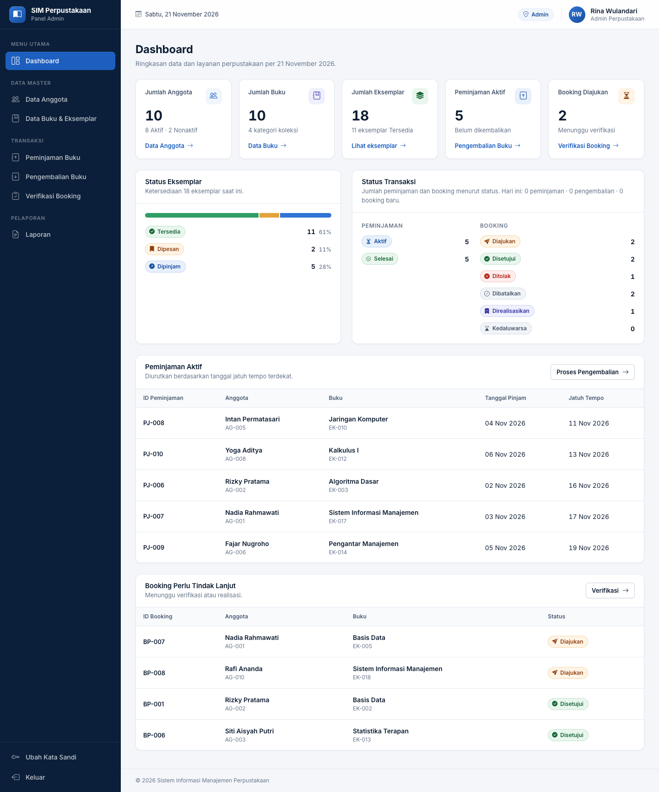

# 9. Hasil Sistem

Status: **COMPLETE**. Aplikasi berjalan dengan MySQL, dibuktikan oleh 31 screenshot aplikasi nyata dan 22 langkah E2E ber-assertion. Ke-7 langkah yang mengubah data diverifikasi dengan kueri ke database uji; langkah lain diperiksa lewat rute atau teks halaman. Tersedia juga panduan instalasi, panduan penggunaan, dan skenario demo.

> Aplikasi berjalan **lokal**. Tidak ada URL produksi atau publik.

| Dokumen | Isi |
| --- | --- |
| [PANDUAN_INSTALASI.md](PANDUAN_INSTALASI.md) | Prasyarat, setup MySQL & `.env` (tanpa rahasia), migrasi, seed, menjalankan Laravel, Vite, penjadwal |
| [PANDUAN_PENGGUNAAN.md](PANDUAN_PENGGUNAAN.md) | Panduan Admin dan Anggota per menu |
| [DEMO_SCENARIO.md](DEMO_SCENARIO.md) | Naskah demo 10 langkah + kebijakan kedaluwarsa 48 jam |
| [`bukti-skenario-demo-2026-11-21.json`](bukti-skenario-demo-2026-11-21.json) | Catatan mesin dari eksekusi demo: langkah, hasil kueri DB, daftar screenshot |

Rujukan QA sistem final:

- Screenshot di folder ini berasal dari eksekusi E2E **21 Nov 2026**.
- Skenario yang sama dijalankan ulang **24 Nov 2026**, setelah remediasi kredensial skrip QA, dan hasilnya kembali 22/22 PASS dengan DB development identik. Bukti: [`../08-SOFTWARE-TESTING/bukti/e2e-skenario-demo-2026-11-24.json`](../08-SOFTWARE-TESTING/bukti/e2e-skenario-demo-2026-11-24.json).
- Ringkasan semua suite (PHPUnit 270/270, Node 245/245, Browser QA lama 23/23 dengan keterbatasan assertion, E2E 22/22) ada di [laporan pengujian](../08-SOFTWARE-TESTING/SOFTWARE_TESTING_REPORT.md).

## Ringkasan arsitektur

Modular monolith Laravel 13 dengan frontend Vue 3 yang dirender lewat Inertia.js (tanpa REST API terpisah). Autentikasi sesi server dengan sesi disimpan di MySQL, otorisasi lewat middleware `peran:*` + Gate, logika domain di Service dengan transaksi InnoDB dan penguncian baris, serta penjadwal untuk kedaluwarsa booking.

```
Browser (Vue 3 + Bootstrap 5.3) ──Inertia XHR──▶ Laravel 13 (Routes → Middleware → Form Request/Gate → Controller → Service → Eloquent)
                                                        │                                             │
                                                        └── php artisan schedule:work → bookings:expire └──▶ MySQL 8.4 (InnoDB)
```

| Lapisan | Teknologi (versi terpasang) |
| --- | --- |
| Backend | Laravel 13.40, PHP 8.4 |
| Frontend | Vue 3.5, Inertia.js 3 (`@inertiajs/vue3` 3.11, `inertia-laravel` 3.7), Bootstrap 5.3.8, Bootstrap Icons, Inter |
| Build | Vite 8.3, Node.js 20 |
| Basis data | MySQL 8.4 LTS (InnoDB, utf8mb4, penyimpanan UTC, tampilan WIB) |
| Pengujian | PHPUnit 12.5, Node test runner, Chrome headless (CDP) |

## Galeri screenshot aplikasi nyata (21 Nov 2026)

**Bagaimana screenshot dibuat:** aplikasi dijalankan dengan `php artisan serve` dan dihubungkan **hanya** ke database uji `sim_perpustakaan_test` yang diisi `DemoPerpustakaanSeeder`. Chrome headless (1440 px) menjalankan skenario demo. Kata sandi akun demo dibangkitkan acak saat runtime dan tidak pernah ditampilkan. Setelah selesai, database uji dikosongkan kembali, dan jumlah baris database development terverifikasi identik sebelum dan sesudahnya. Semua nama dan kontak adalah data demo fiktif dari seeder proyek.

### Admin

| # | Layar | Screenshot |
| --- | --- | --- |
| 1 | Halaman masuk | [00-login.png](screenshots/00-login.png) |
| 2 | Dashboard (agregasi SQL) | [admin/01-dashboard.png](screenshots/admin/01-dashboard.png) |
| 3 | Data Anggota | [admin/02-data-anggota.png](screenshots/admin/02-data-anggota.png) |
| 4 | Tambah Anggota + Akses Login | [admin/03-tambah-anggota.png](screenshots/admin/03-tambah-anggota.png) |
| 5 | Anggota tersimpan (pesan sukses) | [admin/04-anggota-tersimpan.png](screenshots/admin/04-anggota-tersimpan.png) |
| 6 | Ubah Anggota | [admin/05-ubah-anggota.png](screenshots/admin/05-ubah-anggota.png) |
| 7 | Data Buku & Eksemplar | [admin/06-data-buku.png](screenshots/admin/06-data-buku.png) |
| 8 | Tambah Buku (2 eksemplar) | [admin/07-tambah-buku.png](screenshots/admin/07-tambah-buku.png) |
| 9 | Buku tersimpan | [admin/08-buku-tersimpan.png](screenshots/admin/08-buku-tersimpan.png) |
| 10 | Ubah Buku | [admin/09-ubah-buku.png](screenshots/admin/09-ubah-buku.png) |
| 11 | Peminjaman (formulir) | [admin/10-peminjaman.png](screenshots/admin/10-peminjaman.png) |
| 12 | Verifikasi Booking | [admin/11-verifikasi-booking.png](screenshots/admin/11-verifikasi-booking.png) |
| 13 | Detail Booking | [admin/12-detail-booking.png](screenshots/admin/12-detail-booking.png) |
| 14 | Booking disetujui (Batas Pengambilan) | [admin/13-booking-disetujui.png](screenshots/admin/13-booking-disetujui.png) |
| 15 | Realisasi Booking | [admin/14-realisasi-booking.png](screenshots/admin/14-realisasi-booking.png) |
| 16 | Bukti realisasi | [admin/15-bukti-realisasi.png](screenshots/admin/15-bukti-realisasi.png) |
| 17 | Pengembalian | [admin/16-pengembalian.png](screenshots/admin/16-pengembalian.png) |
| 18 | Pengembalian berhasil | [admin/17-pengembalian-berhasil.png](screenshots/admin/17-pengembalian-berhasil.png) |
| 19 | Laporan Peminjaman | [admin/18-laporan-peminjaman.png](screenshots/admin/18-laporan-peminjaman.png) |
| 20 | Laporan Pengembalian | [admin/19-laporan-pengembalian.png](screenshots/admin/19-laporan-pengembalian.png) |
| 21 | Dashboard setelah transaksi | [admin/20-dashboard-setelah-transaksi.png](screenshots/admin/20-dashboard-setelah-transaksi.png) |

### Anggota

| # | Layar | Screenshot |
| --- | --- | --- |
| 1 | Ubah Kata Sandi (wajib saat login pertama) | [anggota/01-wajib-ubah-kata-sandi.png](screenshots/anggota/01-wajib-ubah-kata-sandi.png) |
| 2 | Dashboard | [anggota/02-dashboard.png](screenshots/anggota/02-dashboard.png) |
| 3 | Cari Buku | [anggota/03-cari-buku.png](screenshots/anggota/03-cari-buku.png) |
| 4 | Detail Buku | [anggota/04-detail-buku.png](screenshots/anggota/04-detail-buku.png) |
| 5 | Ajukan Booking | [anggota/05-ajukan-booking.png](screenshots/anggota/05-ajukan-booking.png) |
| 6 | Booking diajukan | [anggota/06-booking-diajukan.png](screenshots/anggota/06-booking-diajukan.png) |
| 7 | Status Booking (Diajukan) | [anggota/07-status-booking.png](screenshots/anggota/07-status-booking.png) |
| 8 | History Peminjaman (Selesai) | [anggota/08-history-peminjaman.png](screenshots/anggota/08-history-peminjaman.png) |
| 9 | Status Booking (Direalisasikan) | [anggota/09-status-booking-akhir.png](screenshots/anggota/09-status-booking-akhir.png) |

### Keamanan

| Layar | Screenshot |
| --- | --- |
| Anggota membuka `/admin/dashboard` → 403 | [keamanan/01-anggota-akses-admin-ditolak.png](screenshots/keamanan/01-anggota-akses-admin-ditolak.png) |

Pratinjau:



> Screenshot di [`docs/screenshots/`](../../screenshots/) (7 Nov 2026) berasal dari **prototipe statis sebelum MySQL**. Screenshot itu dipertahankan sebagai acuan desain (lihat [07-GOOGLE-STITCH](../07-GOOGLE-STITCH/README.md)), bukan sebagai bukti hasil sistem final.
