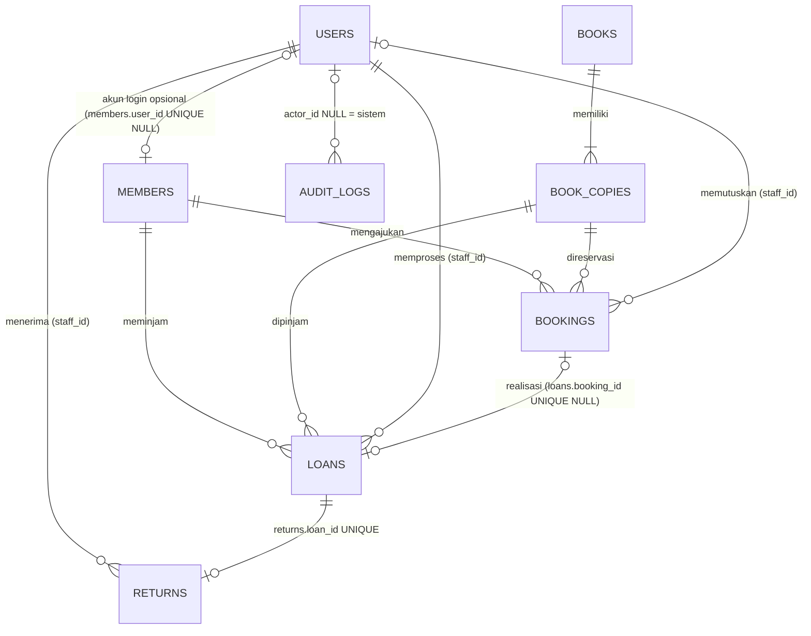

# Phase 7A — Fondasi Database MySQL

SIM Perpustakaan · Laravel 13 · MySQL 8.4 LTS · InnoDB · utf8mb4

| Metadata | Nilai |
| --- | --- |
| Tanggal | 14 November 2026 |
| Status | **Phase 7A selesai (14 Nov 2026).** Stage A, Stage B, revisi D-01..D-08, dan **Stage C** (migration + seeder + verifikasi) selesai. Lihat §2.6 |
| Sumber desain | `PHASE_7_DATABASE_DESIGN_SIM_PERPUSTAKAAN.md` **Draft v0.9** (7 Nov 2026) + keputusan yang disetujui pada instruksi Phase 7A |
| Dokumen yang diminta tetapi tidak ditemukan | `docs/database/phase7/PHASE_7_DATABASE_DESIGN_SIM_PERPUSTAKAAN_v0_10.md`, `PHASE_7_ERD_SIM_PERPUSTAKAAN.png` |
| Pratinjau DDL | [`PHASE_7A_DDL_PREVIEW.sql`](PHASE_7A_DDL_PREVIEW.sql) (dihasilkan dari migration, tidak dijalankan) |

> UI, rute, dan data mock **tidak diubah**. Halaman masih memakai store mock di browser; integrasi backend dimulai Phase 8.

## 1. Ruang lingkup yang dikerjakan

- Konfigurasi koneksi MySQL (`mysql`) dan koneksi uji terpisah (`mysql_testing`).
- Migration delapan tabel domain: `users`, `members`, `books`, `book_copies`, `bookings`, `loans`, `returns`, `audit_logs`.
- Model Eloquent, enum status, cast `TanggalSaja` untuk `due_date`, helper waktu `App\Support\WaktuPerpustakaan` (UTC/WIB, D-02).
- Seeder development dari data mock (idempoten, tanpa kata sandi di source).
- Test database MySQL (skip otomatis bila MySQL uji belum tersedia).
- Skrip penyiapan database lokal untuk dijalankan pemilik proyek.

Tidak dikerjakan (sesuai batas Phase 7A): service transaksi, autentikasi Laravel, scheduler kedaluwarsa booking, perubahan UI/Figma, commit/push.

## 2. Blocker eksekusi (wajib ditangani pemilik proyek)

### 2.1 Diagnostik instance MySQL (read-only, 14 Nov 2026)

| Aspek | Temuan |
| --- | --- |
| Layanan | Homebrew `mysql@8.4` 8.4.4_3, `started`, LaunchAgent `~/Library/LaunchAgents/homebrew.mxcl.mysql@8.4.plist` |
| Proses | Satu-satunya `mysqld` (PID 1130, sejak 6 Nov 2026) via `mysqld_safe --datadir=/opt/homebrew/var/mysql` |
| Binary | `/opt/homebrew/opt/mysql@8.4/bin/{mysqld,mysql}` 8.4.4. Klien `mysql` di PATH adalah **8.0.32** dari `/usr/local/bin/homebrew/...` (instalasi lama, tidak berjalan) |
| Konfigurasi aktif | Urutan baca `/etc/my.cnf` → `/etc/mysql/my.cnf` → **`/opt/homebrew/etc/my.cnf`** → `~/.my.cnf`. Hanya `/opt/homebrew/etc/my.cnf` yang ada. Tidak ada `mysqld-auto.cnf` (tidak ada `SET PERSIST`) |
| `[mysqld]` | `bind-address = 127.0.0.1`, `mysqlx-bind-address = 127.0.0.1`, `plugin-load-add=mysql_native_password.so`. Baris terakhir satu-satunya selisih dari `my.cnf.default` Homebrew |
| Port / socket | `127.0.0.1:3306`, `127.0.0.1:33060`, `/tmp/mysql.sock` (milik PID 1130), `/tmp/mysqlx.sock`. Tidak terekspos publik |
| Datadir | `/opt/homebrew/var/mysql`, **23 GB, ±100 database proyek lain**. Riwayat: 8.0.32 (Mar 2023) → 8.0.33 → 8.2 (Des 2023) → 8.4.2 (Agu 2024) → 8.4.3 → 8.4.4 |
| Log | `MacBook-Air-Doni.local.err` (8,6 juta baris). Sejak 2 Jul 2025, setiap startup (172×): `Can't open shared library .../mysql_native_password.so` |
| Pemakai lain | ±30 proyek di `~/Aplikasi` menunjuk instance ini, **29 memakai user `root`**. Beberapa aktif menulis data 29 Okt–6 Nov 2026 (`icar_db`, `intracopenta_db`, `suryatama_l12`, `szk_db`) |

### 2.2 Akar masalah ERROR 1524

1. MySQL 8.4 menyertakan `mysql_native_password` secara **built-in tetapi nonaktif secara default**. Plugin itu tidak tersedia sebagai `.so` (tidak ada di `lib/plugin`). Karena itu `plugin-load-add=mysql_native_password.so` (ditambahkan sekitar 1 Jul 2025) **tidak berefek** dan hanya menghasilkan error saat startup. Cara yang benar di 8.4 adalah opsi `mysql_native_password=ON`.
2. Data directory berasal dari 8.0; akun `mysql_native_password` dipakai normal sampai 2024 (peringatan deprecation di log Des 2023–Mar 2024). Sejak upgrade ke 8.4 (Agu 2024) semua akun native **tidak bisa login**.
3. Login dengan username yang **tidak ada** juga menghasilkan 1524. ~~Dugaan awal: ada akun anonim berplugin native.~~ **Dibantah oleh Stage A (14 Nov 2026):** tidak ada akun anonim dan tidak ada akun native. Error 1524 untuk username yang tidak ada adalah pesan menyesatkan dari autentikasi tiruan (*decoy*) server untuk user yang tidak dikenal. Artinya error yang ditemui `sim_perpus_app` sebelumnya sebenarnya berarti **"user belum ada"**.
4. **`root` tidak terdampak (terverifikasi Stage A):** `root@localhost` memakai `caching_sha2_password`, tidak terkunci, password tidak kedaluwarsa. Ketujuh akun di server memakai `caching_sha2_password`.

Kesimpulan: **pembuatan database SIM Perpustakaan tidak memerlukan perubahan `my.cnf`, restart, atau perubahan akun mana pun.** Tahap C dan D tidak diperlukan. Baris `plugin-load-add` hanya menyebabkan error kosmetik saat startup (tahap E, opsional).

**Hasil Stage A (14 Nov 2026, read-only):** MySQL 8.4.4 Homebrew; `CURRENT_USER()=root@localhost`; datadir `/opt/homebrew/var/mysql/`; socket `/tmp/mysql.sock`; port 3306; `bind_address` dan `mysqlx_bind_address` `127.0.0.1`; `authentication_policy` `*,,`; plugin `caching_sha2_password` ACTIVE, `sha256_password` ACTIVE, `mysql_native_password` DISABLED; tidak ada komponen terpasang (tidak ada `validate_password`); 7 akun, semuanya `caching_sha2_password`; tidak ada akun anonim; `sim_perpustakaan_db`, `sim_perpustakaan_test`, `sim_perpus_app`, `sim_perpus_test` belum ada.

### 2.3 Rencana pemulihan bertahap (menunggu persetujuan)

Kebijakan: tidak ada `--skip-grant-tables`, tidak ada reset password root, tidak reinstall atau inisialisasi datadir, tidak menghapus database.

| Tahap | Aksi | Mengubah sistem? | Dampak ke ±30 proyek lain |
| --- | --- | --- | --- |
| A | `bash scripts/db/diagnosa-auth-mysql.sh` (admin `root`): versi, plugin, daftar akun non-caching_sha2 dan anonim; tanpa hash | Tidak | Tidak ada |
| B | Bila root bisa login: `bash scripts/db/siapkan-mysql-lokal.sh` | Hanya menambah 2 DB + 2 user baru | Tidak ada |
| C | ~~Backup `my.cnf`, `mysql_native_password=ON`, restart~~ | — | **Tidak diperlukan** (root dan semua akun sudah caching_sha2) |
| D | ~~Migrasi akun native, hapus akun anonim~~ | — | **Tidak diperlukan** (tidak ada akun native maupun anonim) |
| E | *(Kosmetik, opsional)* Hapus baris `plugin-load-add=mysql_native_password.so` | Ya, butuh restart | Tidak ada perubahan perilaku (baris itu memang gagal); hanya menghilangkan error startup |

Perintah tahap C (**jangan dijalankan tanpa persetujuan eksplisit**):

```bash
cp -p /opt/homebrew/etc/my.cnf /opt/homebrew/etc/my.cnf.bak-$(date +%Y%m%d-%H%M%S)
sed -i '' 's/^plugin-load-add=mysql_native_password\.so$/mysql_native_password=ON/' /opt/homebrew/etc/my.cnf
/opt/homebrew/opt/mysql@8.4/bin/my_print_defaults mysqld      # verifikasi
brew services restart mysql@8.4
tail -n 20 /opt/homebrew/var/mysql/MacBook-Air-Doni.local.err  # pastikan "ready for connections"
# rollback: cp -p /opt/homebrew/etc/my.cnf.bak-<stamp> /opt/homebrew/etc/my.cnf && brew services restart mysql@8.4
```

Pencegahan untuk database yang sudah ada: tidak ada `DROP`/`migrate:fresh`/`db:wipe`; skrip setup berhenti bila nama target sudah ada; user SIM Perpustakaan tidak punya hak pada database lain; disarankan `mysqldump` database penting sebelum tahap C/D.

### 2.4 Pembuatan database (least privilege)

`scripts/db/siapkan-mysql-lokal.sh`:

1. **Tahap 1 (read-only):** memastikan versi `8.4.x`, `datadir=/opt/homebrew/var/mysql/`, `bind_address=127.0.0.1`, dan bahwa DB/user target belum ada. Bila tidak sesuai, berhenti.
2. Menampilkan rencana dan meminta Anda mengetik `YA`.
3. **Tahap 2:** membuat objek berikut lewat socket `/tmp/mysql.sock`.

| Objek | Hak |
| --- | --- |
| `sim_perpustakaan_db` (utf8mb4 / `utf8mb4_0900_ai_ci`) | — |
| `sim_perpustakaan_test` | — |
| `sim_perpus_app@localhost`, `@127.0.0.1` (`caching_sha2_password`) | `SELECT, INSERT, UPDATE, DELETE, CREATE, ALTER, DROP, INDEX, REFERENCES` **hanya** pada `sim_perpustakaan_db` |
| `sim_perpus_test@localhost`, `@127.0.0.1` | Hak yang sama, **hanya** pada `sim_perpustakaan_test` |

Tanpa `GRANT OPTION` dan tanpa hak global. Kata sandi kedua user dibuat acak (32 karakter) di `.env` lokal, dikirim lewat stdin, dan tidak dicetak.

**Hasil Stage B (14 Nov 2026, 13:44 WIB):** dijalankan dengan kredensial root lewat file opsi sementara berizin 600, yang dihapus setelah selesai. Konfirmasi `YA` diberikan lewat `SETUJU_TAHAP_B=YA` karena sesi tanpa terminal (persetujuan tertulis pemilik). Diff snapshot sebelum dan sesudah: +2 skema, +4 akun, +4 grant level-database, **0 objek lama berubah**. `SHOW GRANTS` hanya `USAGE ON *.*` ditambah 9 hak pada database masing-masing; 0 hak dinamis global. Koneksi Laravel: `mysql` = `sim_perpus_app@127.0.0.1` → `sim_perpustakaan_db`, `mysql_testing` = `sim_perpus_test@127.0.0.1` → `sim_perpustakaan_test` (strict, utf8mb4; zona sesi saat itu +07:00, kini `+00:00` sesuai D-02). Akses lintas database dan `CREATE DATABASE` ditolak (1044). Password root dihapus dari `.env`.

> **Perhatian:** `php artisan test` (penuh) akan menjalankan `migrate` pada `sim_perpustakaan_test` lewat `MySqlTestCase`. Jalankan setelah migration disetujui. Sebelum itu, test non-database dijalankan per path: `vendor/bin/phpunit --testsuite Unit`, `vendor/bin/phpunit tests/Feature/ExampleTest.php`, `vendor/bin/phpunit tests/Feature/NavigasiDemoTest.php`.

### 2.5 Urutan eksekusi migration dan test

Hanya setelah §2.4 berhasil:

```bash
cd /Users/donisuhendar/Aplikasi/S1/SIM-Perpustakaan
export PATH="/opt/homebrew/opt/php@8.4/bin:$PATH"

# 1. Verifikasi target: MySQL 8.4.x, kedua database 0 tabel
php artisan db:show --database=mysql
php artisan db:show --database=mysql_testing
# 2. Kompatibilitas skema: tinjau PHASE_7A_DDL_PREVIEW.sql (dihasilkan offline).
#    JANGAN memakai `migrate --pretend`: perintah itu tetap membuat tabel `migrations`.
# 3a. Bukti empiris pertama di database UJI (46 test; otomatis `migrate` pada sim_perpustakaan_test)
php artisan test tests/Feature/Database --display-skipped
# 3b. Bila 3a lulus tanpa skip: migration development (non-destruktif)
php artisan migrate --database=mysql
# 4. Verifikasi tabel, indeks, constraint
php artisan db:show --database=mysql
php artisan db:table loans --database=mysql
php artisan db:table bookings --database=mysql
# 5. Seeder development
php artisan db:seed --database=mysql
# 6. Verifikasi data seed (harus 11/10/10/18/8/10/5)
php artisan tinker --execute="foreach (['users','members','books','book_copies','bookings','loans','returns'] as \$t) echo \$t.'='.DB::table(\$t)->count().PHP_EOL; print_r((new App\Support\PemeriksaInvarianData)->periksa());"
# 7–9. Regresi
npm run test:data
php artisan test
npm run build
```

### 2.6 Hasil Stage C (14 Nov 2026)

| Langkah | Hasil |
| --- | --- |
| Gerbang keamanan | Kedua DB ada dan 0 tabel; `CURRENT_USER()` = `sim_perpus_app@127.0.0.1` / `sim_perpus_test@127.0.0.1`; grant hanya `USAGE ON *.*` + hak pada DB sendiri; akses lintas DB ditolak (1142); tanpa cache config; dalam konteks `testing` koneksi `mysql` menunjuk `:memory:` |
| Test MySQL di `sim_perpustakaan_test` | Run 1: 43/46 (3 gagal karena bug helper test `[default] + $lain` di `MySqlTestCase` — override test diabaikan). Diperbaiki menjadi `$lain + [default]` (khusus test, tanpa perubahan skema). Run 2: **46/46 lulus, 0 skip** |
| Migration `sim_perpustakaan_db` | `php artisan migrate --database=mysql`: 10/10 `Ran` batch 1; 15 tabel (8 domain + `migrations` + 6 infrastruktur), 12 FK RESTRICT, 13 UNIQUE, 23 indeks, 7 CHECK, 2 generated column; struktur identik dengan DB uji |
| Seeder | `php artisan db:seed --database=mysql`: users 11, members 10, books 10, book_copies 18, bookings 8, loans 10, returns 5, audit_logs 0 |
| Audit integritas (read-only) | 0 pelanggaran: orphan, duplikat, unique bersyarat, akun ↔ anggota, booking ↔ loan, kosakata status, tanggal WIB vs JSON (jam simpan 05:00 UTC), turunan status eksemplar, `PemeriksaInvarianData`, kebijakan hash D-08 |
| Regresi | `npm run test:data` 193/193; `php artisan test` 88/88 (42 non-DB + 46 MySQL); `npm run build` berhasil; checksum seluruh tabel development identik sebelum/sesudah `php artisan test` |

## 3. Variabel environment

| Variabel | Contoh | Keterangan |
| --- | --- | --- |
| `DB_CONNECTION` | `mysql` | |
| `DB_HOST` / `DB_PORT` | `127.0.0.1` / `3306` | Hanya lokal |
| `DB_DATABASE` | `sim_perpustakaan_db` | Database development |
| `DB_USERNAME` / `DB_PASSWORD` | `sim_perpus_app` / *(rahasia lokal)* | Jangan di-commit |
| `DB_CHARSET` / `DB_COLLATION` | `utf8mb4` / `utf8mb4_0900_ai_ci` | Case-insensitive untuk username dan kode |
| `DB_TEST_DATABASE` | `sim_perpustakaan_test` | **Wajib** berakhiran `_test`; test gagal bila sama dengan `DB_DATABASE` |
| `DB_TEST_USERNAME` / `DB_TEST_PASSWORD` | `sim_perpus_test` / *(rahasia lokal)* | User khusus database uji (least privilege) |
| `SEED_ADMIN_PASSWORD` | *(rahasia lokal, 6–64 karakter)* | Provisioning kata sandi Admin awal (D-08); sudah dibuat acak di `.env` lokal |

Zona waktu **tidak** diatur lewat env (D-02): `app.timezone = UTC` dan zona sesi MySQL `+00:00` ditulis tetap di `config/app.php` dan `config/database.php`; zona tampilan `Asia/Jakarta` di `config/perpustakaan.php`. Variabel `DB_TIMEZONE` dan `SEED_ANGGOTA_DEMO_PASSWORD` sudah tidak dipakai.

`.env` tidak di-commit (`.gitignore`) dan diberi izin `600`. `.env.example` hanya berisi placeholder.

## 4. Skema dan relasi



| Tabel | Kode bisnis (UNIQUE) | Kolom penting |
| --- | --- | --- |
| `users` | `username` | `name` (NULL; wajib untuk Admin, wajib NULL untuk Anggota), `password` (hash), `role` ∈ {admin, anggota}, `is_active` (khusus Admin), `remember_token` NULL |
| `members` | `member_code` (AG-001) | `user_id` NULL UNIQUE, `name`, `contact`, `status` ∈ {Aktif, Nonaktif} |
| `books` | `book_code` (BK-001) | `title`(200), `author`(100), `publisher`(100), `publication_year`, `category`(50) |
| `book_copies` | `copy_code` (EK-001) | `book_id`, `status` ∈ {Tersedia, Dipesan, Dipinjam} |
| `bookings` | `booking_code` (BP-001) | `member_id`, `copy_id`, `status` (5 nilai), `submitted_at`, `decided_at`, `staff_id`, `rejection_reason`(200), `reserved_copy_id` (generated) |
| `loans` | `loan_code` (PJ-001) | `member_id`, `copy_id`, `staff_id`, `booking_id`, `loaned_at`, **`due_date DATE NOT NULL`**, `status` ∈ {Aktif, Selesai}, `active_copy_id` (generated) |
| `returns` | `return_code` (KB-001) | `loan_id` UNIQUE, `staff_id`, `returned_at` |
| `audit_logs` | — | `actor_id`, `action`, `subject_type`, `subject_id`, `metadata` JSON, `created_at` (tanpa `updated_at`) |

Semua PK `BIGINT UNSIGNED AUTO_INCREMENT`; FK memakai ID internal. Waktu kejadian `DATETIME(6)` berisi **UTC** (D-02); `due_date` DATE berisi tanggal kalender WIB tanpa konversi.

### 4.1 Constraint integritas

| Aturan | Mekanisme DB |
| --- | --- |
| Username dan semua kode bisnis unik, tidak peka huruf besar/kecil | UNIQUE + collation `utf8mb4_0900_ai_ci` |
| Anggota maksimal satu akun; banyak Anggota boleh tanpa akun | `uq_members_user_id` (MySQL mengizinkan banyak NULL) |
| Maksimal satu peminjaman **Aktif** per eksemplar | `loans.active_copy_id = CASE WHEN status='Aktif' THEN copy_id END` STORED + `uq_loans_active_copy` |
| Maksimal satu booking **Disetujui** per eksemplar | `bookings.reserved_copy_id = CASE WHEN status='Disetujui' THEN copy_id END` STORED + `uq_bookings_reserved_copy` |
| Satu booking maksimal satu peminjaman (satu sumber tautan) | `uq_loans_booking_id`; tidak ada `bookings.loan_id` |
| Maksimal satu pengembalian per peminjaman | `uq_returns_loan_id` |
| Kosakata status/role, **peka huruf besar/kecil dan aksen** | Kolom `role`/`status` ber-collation `utf8mb4_bin` + CHECK `chk_users_role`, `chk_members_status`, `chk_book_copies_status`, `chk_bookings_status`, `chk_loans_status` |
| Tidak ada Status Akses terpisah bagi Anggota (D-03) | CHECK `chk_users_anggota_tanpa_status_akses` (`role='admin' OR is_active=1`) |
| `users.name` hanya identitas Admin; nama Anggota satu sumber di `members.name` (D-01) | CHECK `chk_users_nama_sesuai_peran` (Admin: `name` tidak NULL dan tidak kosong; Anggota: `name IS NULL`) |
| Riwayat tidak terhapus berantai | Semua 12 FK domain `ON DELETE RESTRICT ON UPDATE RESTRICT` |

Invarian lintas tabel yang **tidak** bisa diekspresikan dengan CHECK/FK (status eksemplar = turunan transaksi, F-01 opsi A, akun Anggota ↔ data Anggota, pemroses harus Admin) diperiksa oleh `App\Support\PemeriksaInvarianData` (dipakai seeder) dan wajib dijaga service transaksional + row lock pada Phase 8+.

### 4.2 Model Eloquent

| Model | Tabel | Tidak fillable (diisi eksplisit oleh proses berwenang) |
| --- | --- | --- |
| `User` | users | `role`, `is_active` |
| `Member` | members | `user_id` |
| `Book` | books | — |
| `BookCopy` | book_copies | `book_id`, `status` |
| `Booking` | bookings | `member_id`, `copy_id`, `status`, `decided_at`, `staff_id` |
| `Loan` | loans | `member_id`, `copy_id`, `staff_id`, `booking_id`, `status` |
| `BookReturn` | returns | `loan_id`, `staff_id` |
| `AuditLog` | audit_logs | `actor_id`; immutable lewat Eloquent |

Status memakai enum PHP (`App\Enums\*`) dengan nilai yang sama dengan SRS/UI. Model dengan kode bisnis memakai trait `PunyaKodeBisnis` (`cariKode()`, scope `kode()`, route key = kode). `User::bolehMasuk()` menyatakan kelayakan login berdasarkan data (Admin: `is_active`; Anggota: `members.status = Aktif`) tanpa memverifikasi kata sandi. `User::$nama_tampilan` (hanya-baca) memberi nama Admin dari `users.name` dan nama Anggota dari `members.name`; UI/Resource Phase 8 memakai atribut ini, bukan `name`.

Semua model domain (turunan `ModelDomain`) dan `User` memakai trait `SimpanWaktuUtc`: objek waktu berzona apa pun dikonversi ke UTC sebelum disimpan. Cast `TanggalSaja` membaca/menulis tanggal kalender WIB dan menserialisasi dari nilai mentah `Y-m-d`.

## 5. Seeder development

`php artisan db:seed` → `DatabaseSeeder` → `DemoPerpustakaanSeeder`.

- Data dari `database/seeders/data/perpustakaan-demo.json`, hasil ekspor mock. `tests/js/seed-data.test.js` memastikan JSON tetap identik dengan `resources/js/data/mock/`.
- Isi: 11 akun (1 Admin `admin` / Rina Wulandari, 10 Anggota), 10 Anggota, 10 Buku, 18 Eksemplar, 8 Booking, 10 Peminjaman, 5 Pengembalian. Tautan realisasi BP-004 → PJ-007 lewat `loans.booking_id`.
- Tanggal mock tanpa jam disimpan sebagai **pukul 12:00 WIB dalam UTC** (mis. `2026-11-02` → `2026-11-02 05:00:00.000000`), konvensi yang sama dengan `resources/js/utils/format.js`. `due_date` disimpan apa adanya.
- Akun Anggota disimpan dengan `users.name = NULL` (D-01). Seeder menolak berjalan bila nama akun Anggota di JSON tidak sama dengan nama Anggota tertautnya.
- **Pengaman:** hanya `APP_ENV` local/testing, driver MySQL, host loopback. Satu transaksi; invarian diperiksa sebelum commit; pelanggaran = rollback penuh.
- **Idempoten:** rekaman dicari berdasarkan username/kode; yang sudah ada tidak diubah atau dihapus.
- **Kata sandi (D-08):** **semua** 10 akun Anggota diberi hash dari string acak yang tidak disimpan di mana pun; tidak ada kata sandi development bersama dan tidak ada kata sandi plaintext di repository. Akun tersebut tidak dapat dipakai masuk sampai Admin mereset kata sandi lewat backend (wajib tersedia pada fase berikutnya).

#### 5.1 Provisioning kredensial Admin awal (D-08)

1. Kata sandi Admin awal dibuat acak (≥ 16 karakter disarankan; aturan L.3: 6–64) dan ditulis **hanya** ke `.env` lokal sebagai `SEED_ADMIN_PASSWORD` (`.env` berizin 600, tidak di-commit). Saat ini sudah terisi 20 karakter acak.
2. Seeder membuat akun `admin` (Rina Wulandari) dengan hash dari nilai tersebut **hanya bila akun belum ada**; menjalankan ulang tidak menimpa hash.
3. Pemilik membaca nilai itu langsung dari `.env` lokal (tidak pernah dicetak oleh seeder, log, atau laporan).
4. Setelah seeding pertama berhasil, `SEED_ADMIN_PASSWORD` boleh dihapus dari `.env`; tanpa nilai ini seeder menolak berjalan, sehingga tidak ada kata sandi bawaan.
5. Mengganti kata sandi Admin dan mereset kata sandi Anggota: fitur backend Admin pada fase berikutnya (belum ada).

## 6. Pengujian

| Lapisan | Perintah | Cakupan |
| --- | --- | --- |
| Data mock + data seed | `npm run test:data` | 193 test termasuk sinkronisasi JSON seed |
| PHP tanpa database | `vendor/bin/phpunit --testsuite Unit` + 2 file `tests/Feature/*Test.php` | 42 test: 19 regresi lama + 23 unit baru (zona waktu UTC/WIB, cast, model, factory, seeder, D-04) |
| PHP database MySQL | `php artisan test tests/Feature/Database` | 46 test (otomatis `migrate` pada DB uji) |

Test database ada di `tests/Feature/Database/` (`SkemaDatabaseTest`, `AkunAnggotaTest`, `IntegritasDataTest`, `SeederDemoTest`), turunan `MySqlTestCase`:

- Memakai koneksi `mysql_testing`; menolak berjalan bila nama database tidak berakhiran `_test` atau sama dengan database development.
- **Tidak memakai `RefreshDatabase`** (yang menjalankan `migrate:fresh`). Cukup `migrate` non-destruktif sekali, lalu setiap test dibungkus transaksi dan di-rollback.
- Bila MySQL uji tidak tersedia, test **di-skip**, tidak dihitung lulus.

Cakupan: konektivitas MySQL 8.4 + strict mode, zona sesi UTC, status migration, InnoDB/utf8mb4, tipe kolom, indeks unik, CHECK, aturan FK RESTRICT, username/kode unik (termasuk beda huruf), akun opsional dan 1:1, hash kata sandi, perlindungan mass assignment, kelayakan login mengikuti Status Anggota, FK menolak rujukan fiktif, penghapusan riwayat ditolak, booking ↔ loan, satu return per loan, unique bersyarat, `due_date` DATE tanpa pergeseran hari, timestamp tersimpan UTC + filter rentang WIB, CHECK nama sesuai peran, indeks D-07, validitas seed, seed berulang, penolakan seed (tanpa kata sandi, env production, data tidak konsisten).

**Belum dibuktikan:** perilaku konkurensi (DB-06..DB-12: dua transaksi paralel). Constraint unik di atas menjadi pengaman terakhir, tetapi protokol lock (member → copy → booking → loan → return) baru diuji saat service Phase 8 tersedia, dengan dua koneksi MySQL sungguhan.

## 7. Rollback dan reset — peringatan

- **Jangan** menjalankan `migrate:fresh`, `migrate:reset`, `db:wipe`, atau `DROP DATABASE` pada database yang berisi data.
- `php artisan migrate:rollback` menjalankan `down()` yang men-`DROP` tabel. Hanya untuk database development yang datanya boleh hilang, dan setelah backup (`mysqldump`).
- Test tidak pernah menyentuh `sim_perpustakaan_db`.
- Untuk mengulang dari awal di lokal: backup → keputusan eksplisit pemilik → baru reset manual.

## 8. Keputusan skema Phase 7A (disetujui pemilik proyek, 14 Nov 2026)

Status: **disetujui untuk revisi skema dan source**. Menjalankan migration/seeder **belum** disetujui.

| # | Topik | Keputusan disetujui | Penerapan |
| --- | --- | --- | --- |
| D-01 | `users.name` | Opsi B: nullable; Admin wajib bernama, Anggota wajib NULL; nama Anggota dari `members.name` | Migration `users` (`name` NULL + `chk_users_nama_sesuai_peran`), `User::$nama_tampilan`, `UserFactory`, seeder, test |
| D-02 | Zona waktu | Simpan UTC, tampilkan Asia/Jakarta (amandemen Phase 0 #7) | `app.timezone=UTC`, sesi MySQL `+00:00`, `perpustakaan.zona_waktu_tampilan`, `WaktuPerpustakaan`, `SimpanWaktuUtc`, `TanggalSaja`, seeder 12:00 WIB→UTC. **DDL tidak berubah** |
| D-03 | CHECK `role='admin' OR is_active=1` | Dipertahankan; Status Anggota satu-satunya pengendali login Anggota | Tidak berubah; tanpa dropdown Status Akses kedua |
| D-04 | `password_reset_tokens` | Dihapus; reset oleh Admin lewat backend | Migration tanpa tabel; broker dihapus dari `config/auth.php` (lihat catatan §8.4) |
| D-05 | `remember_token` | Dipertahankan nullable; "Ingat saya" belum aktif | Tidak berubah |
| D-06 | Isolasi pengujian | DB dan user uji terpisah (`sim_perpustakaan_test` / `sim_perpus_test`) | Sudah sejak Stage B; `MySqlTestCase` menolak DB tanpa akhiran `_test` atau sama dengan DB dev |
| D-07 | Indeks | Hapus `idx_members_status`; pertahankan `idx_loans_staff`, `idx_returns_staff` | Migration `members` |
| D-08 | Akun Anggota seed | Hash acak; tanpa kata sandi bersama; provisioning Admin terdokumentasi | Seeder; opsi `SEED_ANGGOTA_DEMO_PASSWORD` (AG-001) **dihapus**; §5.1 |
| K-01 | Collation `role`/`status` | `utf8mb4_bin` | Diterapkan sebelumnya |

### 8.1 Kedaluwarsa booking — arah disetujui, rincian ditangguhkan

**Disetujui:** booking kedaluwarsa wajib **berpindah keluar dari status `Disetujui`**, sehingga `reserved_copy_id` menjadi NULL, reservasi eksemplar terlepas, dan UNIQUE booking Disetujui tetap konsisten (tidak ada eksemplar terkunci permanen).

**Belum disetujui:** nama status final (`Kedaluwarsa` atau representasi pembatalan otomatis), durasi, frekuensi scheduler. Tidak dipilih sepihak.

Kesesuaian migration awal: CHECK `chk_bookings_status` hanya lima status SRS, dan `reserved_copy_id` hanya terisi untuk `Disetujui`. Penerapan nanti cukup migration aditif: ubah `chk_bookings_status`, tambah case `StatusBooking`, scheduler yang mengubah status dan mengembalikan eksemplar ke `Tersedia` dalam satu transaksi, plus invarian `PemeriksaInvarianData`. Representasi "tetap `Disetujui` + `expires_at`" **tidak** sesuai arah yang disetujui. Waktu acuan (`decided_at`) sudah tersimpan.

### 8.2 Keputusan terbuka lain yang tidak mengubah DDL 7A

- OPEN-05: Anggota Nonaktif tetap dapat dikembalikan pinjamannya oleh Admin (usulan v0.9). Ini aturan service.
- TBD-06 / KD 5.4: larangan booking ganda oleh anggota yang sama tetap aturan aplikasi, belum menjadi constraint.
- Panjang field: validator JS saat ini tidak membatasi judul/penulis/penerbit/kategori. Validasi server Phase 8 harus mengikuti batas DB (200/100/100/50).
- Batas tahun terbit (≤ tahun berjalan) divalidasi server, bukan CHECK.

### 8.3 Aturan waktu untuk Phase 8 (D-02)

| Kebutuhan | Wajib dipakai | Dilarang |
| --- | --- | --- |
| Mengisi timestamp kejadian | `WaktuPerpustakaan::sekarangUtc()` atau `now()` (UTC) | — |
| "Hari ini" (Dashboard, default tanggal pinjam/kembali, validator) | `WaktuPerpustakaan::hariIni()` | `today()`, aturan validasi `'today'`/`'after:today'` (UTC, salah pukul 00:00–06:59 WIB) |
| Filter periode laporan (FR-014/015) | `[$mulai, $sebelum] = WaktuPerpustakaan::rentangHariUtc($awal, $akhir)` lalu `>= $mulai` dan `< $sebelum` | `DATE(kolom)`, `whereDate()` pada kolom UTC |
| Tanggal kalender dari timestamp | `WaktuPerpustakaan::tanggalLokal($instant)` | `$instant->format('Y-m-d')` pada objek UTC |
| `due_date` | string `Y-m-d` atau objek waktu (diambil tanggal WIB-nya oleh `TanggalSaja`) | — |
| Kirim ke frontend | Serialisasi bawaan (ISO-8601 `...Z`; `due_date` `Y-m-d`); `format.js` menampilkan WIB | Memformat ulang ke WIB di PHP untuk JSON |

Binding query builder tidak melewati konversi model: kirim objek UTC (hasil helper di atas). Log Laravel kini bertimestamp UTC.

### 8.4 Catatan konfigurasi auth (D-04)

Laravel 11+ menggabungkan default framework `auth.passwords.users` ke konfigurasi aplikasi, sehingga entri broker itu tetap terlihat di `config('auth.passwords')` walaupun sudah dihapus dari `config/auth.php`. `auth.defaults.passwords` sengaja tidak diisi, jadi `Password::broker()` gagal cepat ("Password resetter [] is not defined"), dan tidak ada kode, rute, atau halaman yang memanggil reset kata sandi (diverifikasi dengan grep dan test unit).

## 9. Langkah berikutnya (Phase 8)

1. Setelah persetujuan eksekusi: jalankan §2.5 (test DB uji dulu, lalu migration + seeder development), pastikan 46 test database lulus tanpa skip.
2. Putuskan nama status, durasi, dan frekuensi scheduler kedaluwarsa booking (§8.1).
3. Autentikasi sesi Laravel (username + hash, `User::bolehMasuk()`, regenerasi sesi, logout) dan middleware peran.
4. Service transaksional (pinjam, kembali, ajukan/setujui/tolak/batal/realisasi booking, ubah status Anggota dengan F-01 opsi A) memakai `DB::transaction` + `lockForUpdate()` dengan urutan lock standar, ditambah test konkurensi dua koneksi.
5. Presenter/Resource Inertia agar Vue menerima bentuk data yang sama dengan mock, lalu migrasi halaman bertahap per modul.
